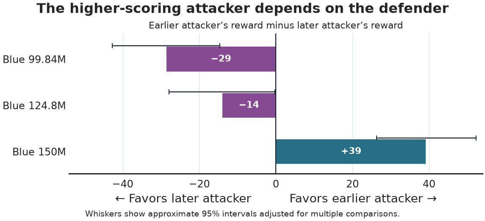

# How well do co-trained cyber policies hold up against new opponents?

**Can a new attacker still improve against Jaxborg’s co-trained defender?** Yes. A new attacker scored about **530 more reward points per simulated episode** against the same defender, and the better of two saved attackers changed when we switched defenders.

## Questions

1. Can an attacker trained against a fixed defender outscore that defender’s original attacker?
2. Does the stronger saved attacker stay stronger when it faces a different defender?

## Method

- **Train a new attacker.** Freeze the final Blue defender and train Red against it. Select an attacker from saved and newly trained candidates on separate episodes, then compare it with the original Red on 4,096 matched test episodes.
- **Swap saved opponents.** Play three saved Reds against three saved Blues from the same co-training run. Use the same 4,096 test cases for each matchup in this separate experiment.

Blue defends and Red attacks. The charts show differences in Red’s average reward per episode. Higher reward favors the attacker.

## Results

### A new attacker scored 530 points more against the same defender

Blue stayed fixed. We changed only Red, and the new Red scored higher on the test episodes.

### The better saved attacker changed with the defender

We compared the same two saved attackers against each defender. The earlier attacker scored lower against the first two defenders and higher against the final defender.

## Discussion

The final co-trained pair still gave Red room to improve by switching strategies. The saved matchups show why a score against one opponent tells us about that matchup. Robustness across opponents takes a wider test.

These results come from one co-training run and one simulated network. Each new attacker trained for about 10M simulation steps. How much more an attacker could gain, and whether the pattern holds across other runs and networks, remain open questions.

Exact values and study evidence

| Comparison | Red reward difference | Approximate simultaneous 95% interval |
| --- | ---: | ---: |
| Adapted minus original Red against final Blue | +530.16 | [517.54, 542.79] |
| Earlier minus later Red against Blue at 99.84M steps | −28.70 | [−42.75, −14.64] |
| Earlier minus later Red against Blue at 124.8M steps | −14.09 | [−27.89, −0.29] |
| Earlier minus later Red against Blue at 150M steps | +39.29 | [26.28, 52.30] |

The intervals describe variation across matched test episodes for these policies. The adapted attacker comparison uses its four-contrast correction family. The saved-policy comparisons use their separate 24-contrast family.

See the [study](README.md) and [replay instructions](reproduce.md) for the full design, saved outcomes, and plot commands.

