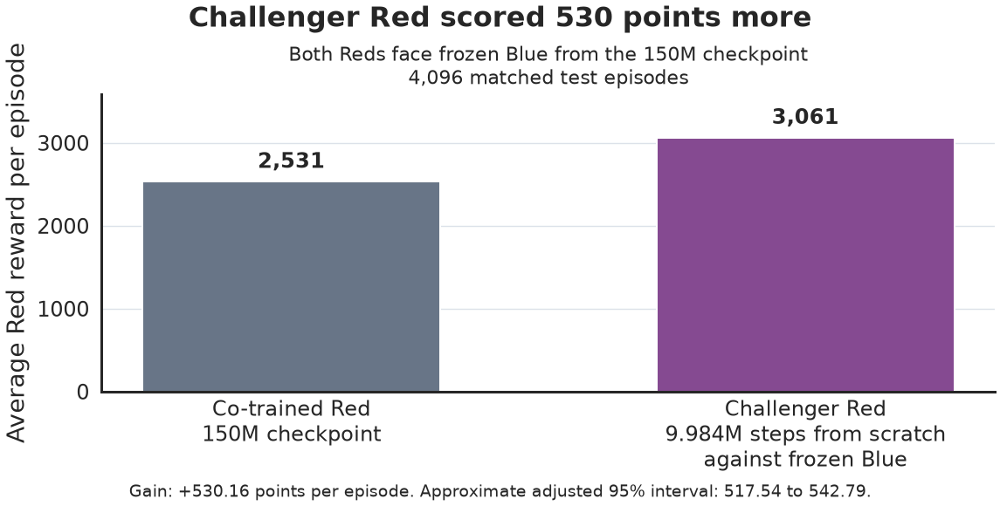
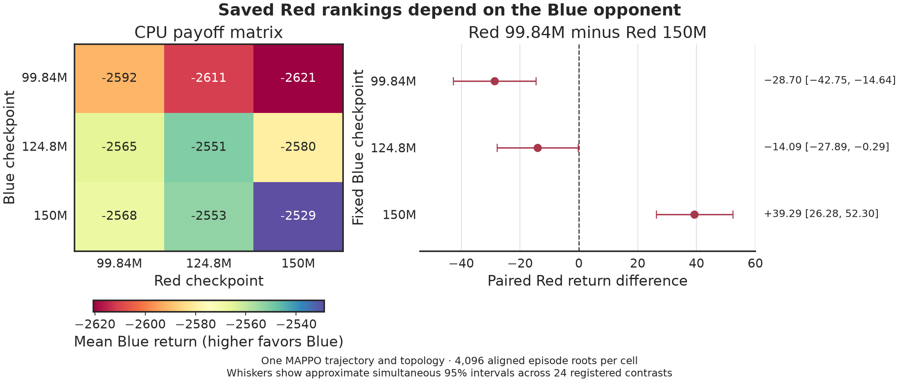

# Challenger Red improved after about 10M training steps

**Can a challenger Red trained from scratch for about 10M steps outscore co-trained Red against the same frozen Blue?** Against Blue frozen at 150M, the selected challenger Red scored about **530 more points per episode**.

## Questions

1. **Fresh response.** Can a short training run produce a challenger Red that beats co-trained Red against the same frozen Blue?
2. **Saved cross-play.** Does the ranking of co-trained Reds depend on which Blue they face?

## Method

- **Train challenger Reds.** Freeze co-trained Blue at the 150M checkpoint and train challenger Reds from scratch against it. Each challenger completed **9,984,000 simulation steps** of a planned 10 million. Select a Red from saved co-trained and freshly trained candidates on separate episodes. Compare the selected challenger Red with co-trained Red at 150M on 4,096 matched test episodes.
- **Swap saved opponents.** Take both Red and Blue from the same three checkpoints in one co-training run, at 99.84M, 124.8M, and 150M simulation steps. Play all nine Red–Blue pairings and run each pairing through the same 4,096 simulation setups.

## Results

### Challenger Red scored 530 points more against frozen Blue

Both Reds faced Blue frozen at the 150M checkpoint. Co-trained Red from that checkpoint averaged **2,531** points per episode. Challenger Red averaged **3,061**.

### Separate test of nine saved Red–Blue matchups

Rows show co-trained Blue checkpoints. Columns show co-trained Red checkpoints. The colored cells show average **Blue** reward. The right panel shows that Red 99.84M scored below Red 150M against the first two Blues and above it against Blue 150M.

## Discussion

The fresh response test found a way for Red to improve while Blue stayed fixed. The saved-policy matrix answers a separate question about how rankings change across opponents.

The 150M study tested saved Blues against frozen Red 150M. Training a fresh challenger Blue against that Red remains open.

These results come from one co-training run and one simulated network. How much more a challenger Red could gain, and whether the pattern holds across other runs and networks, remain open questions.

Exact values and study evidence

| Comparison | Red reward difference | Approximate simultaneous 95% interval |
| --- | ---: | ---: |
| Challenger minus co-trained Red against frozen Blue 150M | +530.16 | [517.54, 542.79] |
| Red 99.84M minus Red 150M against Blue at 99.84M steps | −28.70 | [−42.75, −14.64] |
| Red 99.84M minus Red 150M against Blue at 124.8M steps | −14.09 | [−27.89, −0.29] |
| Red 99.84M minus Red 150M against Blue at 150M steps | +39.29 | [26.28, 52.30] |

The intervals describe variation across matched test episodes for these policies. The challenger Red comparison uses its four-contrast correction family. The saved-policy comparisons use their separate 24-contrast family.

See the [study](README.md) and [replay instructions](reproduce.md) for the full design, saved outcomes, and plot commands.

