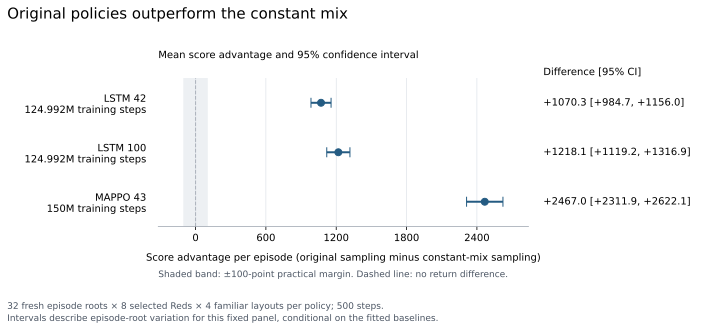

# Why does sampling beat argmax?

**Finding:** The original sampled policies substantially beat a constant action
mix. The reason sampling beats argmax remains open.

**Why we asked.** The earlier test ran the same trained policies with sampling
or argmax, keeping observations and LSTM memory enabled. Sampling scored higher;
argmax repeated actions more and covered fewer hosts. Could useful action
variety from a constant mix explain the performance?

**What we tried.**

1. Run each of three already trained policies for 64 calibration episodes,
   recording its predicted action probabilities.
2. Fit a separate baseline: one constant set of action-and-target weights per
   Blue agent. It samples legal actions without observations, memory or a clock.
3. Compare baseline sampling with original-policy sampling on fresh episodes,
   against the same attackers. Red keeps sampling. No neural networks are retrained.

**Result.** Each original policy beat its fitted constant mix. Every 95%
interval exceeded the declared 100-point meaningful gain.

[Exact results and supporting measurements](reported-results.json).

**Possible explanation for the argmax gap.** Argmax may repeatedly pick the
same highest-ranked action or target, missing lower-probability choices that
provide useful sensing, recovery or coverage. Sampling keeps those choices in
play. The observed repetition and coverage differences fit this hypothesis;
they do not establish the cause.

**Still open.** The advantage over a constant mix could come from a changing
phase/time schedule, reactions to attacks on particular hosts, or both.

**Suggested next experiment.** Fit a baseline whose action-and-target mix varies
with phase, time and layout, without live host evidence. Compare that sampled
schedule with original sampling and argmax on matched fresh cases. This tests
how much performance scheduling alone can reproduce; the argmax mechanism
would still need a separate test.

**Scope.** Two LSTM seeds at 124.992M training steps and one MAPPO trajectory at
150M; 6,144 test episodes against eight selected attackers on four familiar
layouts. Intervals describe variation across 32 test roots, conditional on the
fitted baselines. They exclude new training runs and baseline refitting. The
earlier argmax comparison used different roots; the two gaps cannot be combined.

The two-part **brief with charts**, exact plotting values and source reports
live under `report/brief-20261110/` in the ITM study root:
`/data/shared/jaxborg/studies/observation-value-20261109/`.
Full measurements: `report/comparison.json` and `report/episodes.csv`.
Earlier study: `/data/shared/jaxborg/studies/action-selection-learned-red-20261109/`.
Tracking: `jaxborg/observation-value-20261109` (experiment 5).
See [methods and reconstruction](reproduce.md).
